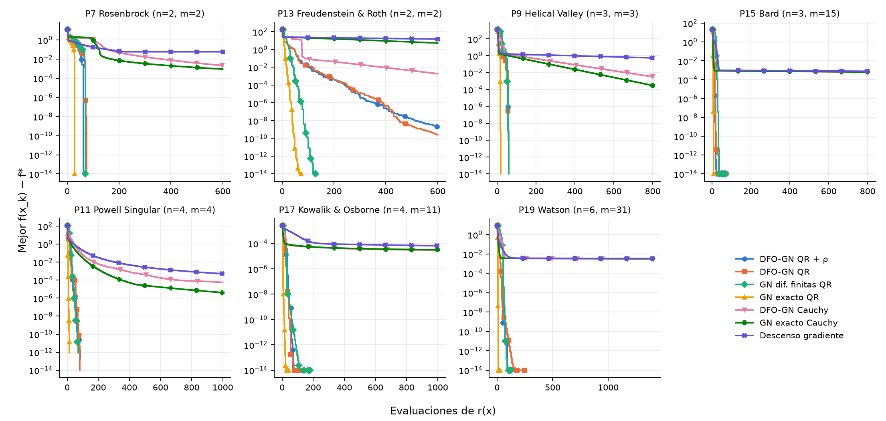
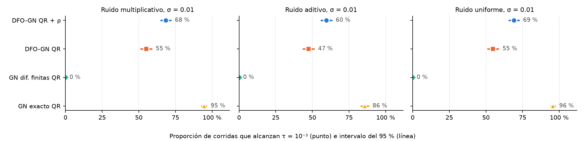
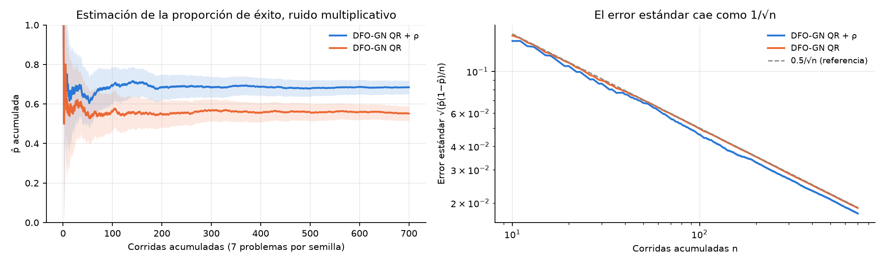

# Proyecto Integrador: Entrega Final

## Implementación de un método Gauss-Newton libre de derivadas para mínimos cuadrados no lineales

**Artículo base:** *A derivative-free Gauss-Newton method* (Cartis y Roberts, 2019)
**Integrantes:** David Castro, Alejandro Pardo, Tomás Rincón
**Curso:** Métodos Numéricos · **Docente:** Edwin Fernando Muñoz
Universidad Externado de Colombia · Bogotá, 2026

---

## 1. Introducción

### 1.1 El artículo original

Cartis y Roberts (2019) proponen DFO-GN para resolver problemas de mínimos cuadrados no lineales, min f(x) = ½‖r(x)‖² con r: ℝⁿ → ℝᵐ, cuando solo se pueden evaluar los residuos r y no sus derivadas. Es el caso de las simulaciones costosas y las mediciones con ruido, donde las diferencias finitas cuestan n evaluaciones adicionales y amplifican el error. En cada iteración, DFO-GN evalúa r en n+1 puntos cercanos y construye un modelo lineal de interpolación r(xₖ+s) ≈ r(xₖ) + Jₖs (ecs. 2.2-2.4). Al elevarlo al cuadrado obtiene un modelo cuadrático de f con g = Jₖᵀr y H = JₖᵀJₖ (ec. 2.5), que minimiza dentro de una región de confianza de radio Δₖ. El cociente Rₖ entre la reducción real y la predicha decide si el paso se acepta y cómo cambia el radio (ecs. 2.6-2.7 y 2.15). Para que el modelo sea confiable, los autores controlan la geometría de los puntos (Λ-poisedness) y protegen el radio con una cota inferior ρₖ y fases de criticidad y de seguridad.

Los autores demuestran convergencia global a un punto crítico con un peor caso de O(ε⁻²) iteraciones. En 53 problemas de Moré y Wild, con y sin ruido, DFO-GN usó un número de evaluaciones comparable al de BOBYQA, DFBOLS y POUNDERS, que usan modelos cuadráticos, y fue entre 7 y 444 veces más rápido que Py-DFBOLS. Con ruido sufre una pequeña penalización, mayor con ruido aditivo.

### 1.2 Objetivos

El objetivo general es implementar en Python una versión de DFO-GN construida con los métodos del curso y evaluar su precisión, su costo y su robustez frente al ruido. Los objetivos específicos son: (i) construir el Jacobiano por interpolación con eliminación de Gauss y el paso con QR, ambos implementados por el equipo; (ii) compararlo con Gauss-Newton con Jacobiano exacto, con diferencias finitas y con descenso del gradiente, usando la métrica N(τ) del artículo; (iii) incorporar la protección del radio ρₖ, la mejora que dejó planteada la segunda entrega, y medir su efecto con ruido; y (iv) estimar mediante simulación Monte Carlo la probabilidad de éxito de cada método con su intervalo de confianza del 95 %.

## 2. Metodología

### 2.1 Cambio metodológico respecto al artículo

Conservamos la idea central del artículo: el Jacobiano por interpolación y la región de confianza. Las piezas que exceden el curso se sustituyen por métodos que sí vimos (Tabla 1). La diferencia frente a la segunda entrega es el radio inferior ρₖ, que ahora se incorpora con los valores del artículo.

**Tabla 1. Algoritmo 1 del artículo frente a nuestra versión final.**

| Elemento | Estado | Nuestra versión |
|---|---|---|
| Interpolación lineal con n+1 puntos (ecs. 2.2-2.4) y modelo de f (2.5) | Conservado | W Jᵀ = D resuelto por eliminación de Gauss |
| Región de confianza, cociente Rₖ con η₁ = 0.1, η₂ = 0.7, regla 2.15 | Conservado | Mismos parámetros y parada (sección 4.3) |
| Subproblema (rutina de DFBOLS/BOBYQA) | Sustituido | Paso de Gauss-Newton por QR con respaldo de Cauchy |
| Geometría Λ-poised | Simplificado | Razón de pivotes < 10⁻⁸ ⇒ reconstrucción |
| Radio inferior ρₖ (α₁ = 0.1, α₂ = 0.5, ρ₀ = Δ₀, ρ_end = 10⁻¹⁰) | Agregado en esta entrega | Δ ≥ ρ; ρ baja tras 3 rechazos seguidos |
| Fases de criticidad y de seguridad | Omitido | Afectan sobre todo la teoría de convergencia |
| Actualización de la factorización (sección 4.4) | Omitido | Con n ≤ 6, resolver desde cero es barato |

### 2.2 Propuesta final y métodos numéricos

Cada paso del algoritmo usa un método del curso (Tabla 2). Todos los métodos de región de confianza comparten un núcleo que combina el origen de J, el tipo de paso y la protección del radio, de modo que cada comparación aísla un solo efecto. El álgebra es propia; SciPy solo se usa para validar.

**Tabla 2. Métodos del curso en la solución final.**

| Método | Función en el proyecto | Tema del curso |
|---|---|---|
| Eliminación de Gauss con pivoteo parcial | Resolver W Jᵀ = D con una sola eliminación para los m residuos | Unidad 3 (S11) |
| Mínimos cuadrados por QR (Gram-Schmidt modificado) | Paso de Gauss-Newton: min ‖Js + r‖ vía Rs = −Qᵀr | Unidad 3 (S12, S14) |
| Punto de Cauchy | Respaldo del paso QR; descenso del gradiente con tasa óptima | Unidad 7 (S23) |
| Diferencias finitas hacia adelante, h = √ε·max(1, \|xⱼ\|) | Comparador: GN con Jacobiano aproximado | Unidades 1 y 2 (S4, S6) |
| Newton para sistemas | Comparador: GN con J exacto (coincide si m = n) | Unidad 4 (S18) |
| Transformada inversa y Monte Carlo | Ruido uniforme; proporción de éxito e intervalo del 95 % | Unidad 6 (S25-S27) |

El procedimiento de cada iteración es: (1) formar W, con filas yₜ − xₖ, y D, con filas r(yₜ) − r(xₖ), y resolver W Jᵀ = D; si la razón entre el menor y el mayor pivote de W/Δ es menor que 10⁻⁸, reconstruir los puntos con pasos coordenados de tamaño Δ; (2) calcular g = Jᵀr y H = JᵀJ; (3) calcular el paso de Cauchy, s = −t·g con t = min(gᵀg/gᵀHg, Δ/‖g‖), y el paso de Gauss-Newton por QR recortado a Δ, y usar el que más baje el modelo; (4) evaluar r(xₖ+s), una sola evaluación, y calcular Rₖ; (5) aceptar si Rₖ ≥ 0.1 y actualizar Δ con la regla 2.15 sin dejarlo bajar de ρ; si Δ ya está en ρ y hubo tres rechazos seguidos, hacer (ρ, Δ) ← (0.1ρ, 0.5ρ); (6) incorporar el punto de prueba, aceptado o no, en lugar del punto más lejano del centro; y (7) detener si f ≤ max(10⁻¹², 10⁻²⁰f(x₀)), si ρ < 10⁻¹⁰ o si se agotan 200(n+1) evaluaciones.

La elección de (3) garantiza el decrecimiento mínimo de la ec. 2.8 del artículo, base de la convergencia global: con J casi singular, el paso de Gauss-Newton recortado puede bajar el modelo menos que el de Cauchy, y sin este respaldo Freudenstein & Roth se detenía en f ≈ 32 en vez de 24.49. El radio inferior responde a la limitación de la segunda entrega: con ruido, un buen paso puede rechazarse; cada rechazo reduce Δ, el error del Jacobiano interpolado crece como σ/Δ y el método termina por radio pequeño sin haber llegado.

### 2.3 Datos y diseño experimental

Usamos siete problemas de la Tabla 2 del artículo, originales de Moré, Garbow y Hillstrom (1981). Pk denota el problema k de esa tabla: P7 Rosenbrock (n = 2, m = 2), P13 Freudenstein & Roth (2, 2; residuo no nulo), P9 Helical Valley (3, 3), P15 Bard (3, 15), P11 Powell Singular (4, 4; J singular en la solución), P17 Kowalik & Osborne (4, 11) y P19 Watson (6, 31). La métrica es la del artículo (ec. 5.1): N(τ) es el número de evaluaciones de r hasta que f(xₖ) ≤ f* + τ(f(x₀) − f*), con τ ∈ {10⁻¹, 10⁻³, 10⁻⁵} y un presupuesto de 200(n+1) evaluaciones.

El ruido sigue la sección 5.2 del artículo, con σ = 10⁻²: multiplicativo, r̃ᵢ = rᵢ(1+ε), y aditivo, r̃ᵢ = rᵢ+ε, con ε ~ N(0, σ²). Agregamos ruido uniforme multiplicativo, que el artículo menciona entre sus pruebas adicionales, generado por transformada inversa: ε = a + (b−a)U con U ~ U(0, 1), a = −√3σ y b = √3σ, de modo que tiene media 0 y la misma varianza σ² que el gaussiano. El algoritmo ve el valor ruidoso; la métrica usa f sin ruido.

La robustez se estima por simulación Monte Carlo. Cada corrida produce un indicador de éxito, 1 si alcanza τ y 0 si no. La proporción p̂ de éxitos estima la probabilidad de éxito, con error estándar √(p̂(1−p̂)/n) e intervalo del 95 % p̂ ± 1.96·EE. Usamos 100 semillas por problema, método y tipo de ruido: 8 400 corridas, 700 por método y ruido. La corrida k usa la semilla 2026 + k en todos los métodos, de modo que todos reciben el mismo ruido y las versiones con y sin ρ se comparan por pares: dₖ = Iₖ(con ρ) − Iₖ(sin ρ), con intervalo d̄ ± 1.96·s_d/√n.

## 3. Validación y reproducibilidad

Validamos cada pieza contra referencias externas. La eliminación de Gauss y QR coinciden con NumPy en 200 sistemas aleatorios, con error de factorización y de ortogonalidad de a lo sumo 8·10⁻¹⁶, y reproducen los ejemplos de la Semana 6 y del Quiz 3. Los siete problemas reproducen el 2f(x₀) de la Tabla 2 del artículo, su Jacobiano analítico coincide con diferencias centradas (error relativo ≤ 2.4·10⁻¹⁰), y `scipy.optimize.least_squares` reproduce los valores 2f*. El generador de ruido uniforme, con 200 000 muestras, dio media −5.8·10⁻⁵ y varianza 9.997·10⁻⁵, frente a los valores teóricos 0 y 10⁻⁴.

El código está en cuatro cuadernos autónomos (Anexo), que se ejecutan completos en Colab o Jupyter: métodos y validación, DFO-GN final, experimentos sin ruido y Monte Carlo con ruido. Todos los parámetros son fijos, con semilla 2026. En dos ejecuciones completas, desde una carpeta vacía, todos los archivos de resultados coincidieron, salvo las columnas de tiempo.

## 4. Resultados y análisis

### 4.1 Sin ruido: el paso pesa más que el origen de J

**Tabla 3. N(τ = 10⁻⁵): evaluaciones de r sin ruido (n/a = no alcanzado).** GN exacto requiere además evaluar J; el descenso del gradiente (DG) usa J exacto.

| Problema | DFO-GN QR + ρ | DFO-GN QR | DFO-GN Cauchy | GN exacto QR | GN exacto Cauchy | GN dif. finitas QR | DG |
|---|--:|--:|--:|--:|--:|--:|--:|
| P7 Rosenbrock | 63 | 71 | n/a | 29 | n/a | 71 | n/a |
| P13 Freudenstein & Roth | 141 | 157 | n/a | 19 | n/a | 45 | n/a |
| P9 Helical Valley | 55 | 55 | 633 | 16 | 457 | 52 | n/a |
| P15 Bard | 14 | 14 | n/a | 6 | n/a | 24 | n/a |
| P11 Powell Singular | 26 | 26 | 371 | 7 | 214 | 35 | 729 |
| P17 Kowalik & Osborne | 39 | 35 | n/a | 8 | n/a | 36 | n/a |
| P19 Watson | 33 | 33 | n/a | 8 | n/a | 56 | n/a |

**Figura 1. Convergencia sin ruido:** mejor f(xₖ) − f* contra evaluaciones de r, en escala logarítmica.

Sin derivadas, DFO-GN QR + ρ alcanza τ = 10⁻⁵ en los siete problemas (Tabla 3). Con solo el paso de Cauchy, ese nivel se alcanza en 2 de 7 problemas, tanto con J interpolado como con J exacto, y en la Figura 1 sus curvas son casi paralelas a las del descenso del gradiente. Esto muestra que el cuello de botella era el paso y no el origen del Jacobiano: Cauchy es un paso de máximo descenso y hereda su lentitud en los valles estrechos. Frente a Gauss-Newton con diferencias finitas, DFO-GN QR + ρ usó menos evaluaciones en cuatro problemas, unas pocas más en Helical Valley y Kowalik, y más del triple en Freudenstein & Roth, de residuo no nulo. Sin ruido, ρ no empeora el método: mejora Rosenbrock (71 → 63) y Freudenstein (157 → 141) y cuesta cuatro evaluaciones en Kowalik. Con J exacto, Gauss-Newton muestra orden empírico p ≈ 1 (eₖ₊₁ ≈ C·eₖᵖ) en Bard, Powell Singular, Kowalik y Watson, lo esperable con residuo no nulo o J singular; en DFO-GN el estimador fue inestable y no sacamos conclusiones.

### 4.2 Con ruido: probabilidad de éxito estimada por Monte Carlo

**Tabla 4. Proporción de corridas que alcanzan τ, de 700 por celda (multiplicativo / aditivo / uniforme).**

| Método | τ = 10⁻¹ | τ = 10⁻³ | τ = 10⁻⁵ |
|---|:--:|:--:|:--:|
| DFO-GN QR + ρ | 78 / 79 / 78 % | 68 / 60 / 69 % | 53 / 30 / 55 % |
| DFO-GN QR | 69 / 77 / 69 % | 55 / 47 / 55 % | 38 / 21 / 37 % |
| GN dif. finitas QR | 0 / 0 / 0 % | 0 / 0 / 0 % | 0 / 0 / 0 % |
| GN exacto QR (usa J exacto) | 100 / 90 / 100 % | 95 / 86 / 96 % | 80 / 60 / 80 % |

**Figura 2. Proporción de éxito para τ = 10⁻³ e intervalo del 95 %, por tipo de ruido.**

El resultado más claro es el fracaso de las diferencias finitas: no alcanzan ninguna tolerancia en las 2 100 corridas con ruido. Con h ≈ 10⁻⁸ y σ = 10⁻², el error del Jacobiano es del orden de σ/h ≈ 10⁶, lo que confirma la motivación del artículo. DFO-GN, que interpola a la escala de Δ y no a la de h, sí avanza. Con τ = 10⁻³ y ρ, alcanza la tolerancia en el 68 % de las corridas con ruido multiplicativo (IC 95 %: 65-72 %), en el 60 % con aditivo (56-63 %) y en el 69 % con uniforme (66-73 %). El ruido gaussiano multiplicativo y el uniforme, de igual varianza, dan resultados casi idénticos: importa la magnitud del ruido, no su distribución. El aditivo es el más difícil, como reportan los autores: no se reduce cerca de la solución, y en Kowalik & Osborne, cuyo f* es del orden de 10⁻⁴, ningún método alcanza τ = 10⁻³ porque la tolerancia queda por debajo del nivel del ruido. Gauss-Newton exacto es solo una referencia: en un problema sin derivadas no está disponible. Cuando p̂ = 0, el intervalo calculado con la aproximación normal tiene ancho cero; eso no indica certeza, sino un límite de esa aproximación en los extremos.

### 4.3 Efecto de la protección del radio

**Tabla 5. Diferencia pareada de éxito, con ρ − sin ρ, en puntos porcentuales e IC del 95 % (700 pares).**

| Ruido | τ = 10⁻¹ | τ = 10⁻³ | τ = 10⁻⁵ |
|---|:--:|:--:|:--:|
| Multiplicativo | +8.4 [6.0, 10.9] | +13.3 [10.1, 16.5] | +15.1 [11.9, 18.4] |
| Aditivo | +2.1 [0.6, 3.7] | +12.1 [9.4, 14.9] | +9.4 [7.1, 11.7] |
| Uniforme | +9.1 [6.9, 11.4] | +14.3 [11.3, 17.3] | +17.7 [14.6, 20.8] |

**Figura 3. Estimación acumulada de p̂ (ruido multiplicativo, τ = 10⁻³) y su error estándar, que cae como 1/√n.**

La protección del radio mejora el éxito en los nueve casos de la Tabla 5, y ninguno de sus intervalos contiene el cero, de modo que la mejora no se explica por el azar de las semillas. Esto confirma la hipótesis que la segunda entrega dejó sin probar. El efecto crece con la exigencia: es mayor para τ = 10⁻⁵ que para τ = 10⁻¹, porque llegar cerca de la solución requiere que Δ no colapse antes. Por problema, la mejora se concentra en Helical Valley (41 → 74 % con ruido multiplicativo), Powell Singular (68 → 100 %), Kowalik (57 → 75 %) y Watson; en Rosenbrock y Freudenstein no hay cambio apreciable. La Figura 3 muestra por qué hacía falta Monte Carlo: con 10 semillas, como en la segunda entrega, los intervalos de las dos versiones se traslapan; con 100 el error estándar baja a cerca de 1.8 puntos y se separan. Reducir el error a la mitad exige cuatro veces más corridas.

### 4.4 Costo computacional

DFO-GN QR + ρ usa entre 1.3 y 2.4 evaluaciones de r por iteración, frente a 1.9-5.0 de Gauss-Newton con diferencias finitas. Su iteración tarda más que la de Gauss-Newton exacto porque resuelve un sistema de Gauss n×n además de la QR m×n, pero con n ≤ 6 son fracciones de milisegundo, despreciables frente a evaluar una r costosa.

### 4.5 Contraste con el artículo

Coincidimos con el artículo en lo cualitativo: un modelo lineal interpolado basta para obtener el comportamiento de Gauss-Newton sin derivadas, sin fracasar con ruido, y el ruido aditivo es el más difícil. No reproducimos su comparación con BOBYQA, DFBOLS y POUNDERS, ni la ventaja de 7 a 444 veces en tiempo frente a Py-DFBOLS, porque no implementamos esos métodos. Usamos 7 problemas en vez de 53, sin perfiles de datos. Nuestra versión es menos robusta con ruido que la de los autores, lo que atribuimos a la geometría simplificada y a las fases de criticidad y de seguridad omitidas: la Tabla 5 muestra que agregar solo una de las protecciones del Algoritmo 1, el radio ρₖ, ya produce una mejora significativa.

## 5. Limitaciones y trabajo futuro

Siete problemas con n ≤ 6 no permiten generalizar a problemas medianos como los de CUTEst. La regla de la razón de pivotes detecta puntos casi alineados, pero no los mejora de forma óptima como el criterio Λ-poised, que maximiza los polinomios de Lagrange del conjunto. Cuando la tolerancia está por debajo del nivel del ruido aditivo, como en Kowalik & Osborne, la métrica N(τ) deja de ser informativa. Y Gauss-Newton exacto sigue siendo mejor con ruido, así que hay margen de mejora.

Como trabajo futuro proponemos: (i) validar nuestra implementación contra el código publicado por los autores en los mismos siete problemas; (ii) incorporar la fase de seguridad y un paso de mejora de geometría con polinomios de Lagrange lineales; (iii) reemplazar el respaldo de Cauchy por un paso dogleg, que combina ambas direcciones; (iv) ampliar las pruebas a problemas de mayor dimensión y reportar perfiles de datos; y (v) medir el tiempo total con una r costosa simulada, para cuantificar el ahorro frente a las diferencias finitas.

## 6. Conclusiones

- Interpolar el Jacobiano con eliminación de Gauss y dar el paso con mínimos cuadrados por QR produce un método sin derivadas que resuelve los siete problemas a τ = 10⁻⁵.
- La elección del paso pesa más que el origen del Jacobiano: con solo el punto de Cauchy se resuelven 2 de 7 problemas, incluso con J exacto.
- Con ruido, las diferencias finitas fracasan en todas las corridas, porque el error del Jacobiano crece como σ/h, mientras la interpolación sigue avanzando.
- El radio inferior ρₖ aumenta la probabilidad de éxito con ruido entre 12 y 14 puntos porcentuales para τ = 10⁻³, con intervalos de confianza que excluyen el cero.
- La simulación Monte Carlo con 100 semillas fue necesaria para afirmar esa mejora: con 10 semillas los intervalos se traslapaban.

## Declaración de uso de inteligencia artificial

Usamos asistentes de inteligencia artificial como apoyo en distintas etapas del proyecto. Claude (Anthropic), en sus modelos Opus 5.5 y Sonnet 5.5, se empleó en la redacción inicial del código en Python, la propuesta de los experimentos y los primeros borradores de los informes y de la presentación. Los modelos DeepSeek V4.1 Flash y DeepSeek V4 Pro se usaron en la revisión cruzada de los documentos, el ajuste de su estructura a los lineamientos de cada entrega y la verificación de la reproducibilidad. Los resultados provienen de la ejecución del código. Como grupo, analizamos línea por línea que todo siguiera los lineamientos del curso.

## Referencias

- Cartis, C., & Roberts, L. (2019). A derivative-free Gauss-Newton method. *Mathematical Programming Computation*, 11, 631-674. https://doi.org/10.1007/s12532-019-00161-7
- Kroese, D. P., Taimre, T., & Botev, Z. I. (2011). *Handbook of Monte Carlo Methods*. Wiley.
- Moré, J. J., Garbow, B. S., & Hillstrom, K. E. (1981). Testing unconstrained optimization software. *ACM Transactions on Mathematical Software*, 7(1), 17-41.
- Moré, J. J., & Wild, S. M. (2009). Benchmarking derivative-free optimization algorithms. *SIAM Journal on Optimization*, 20(1), 172-191.
- Nocedal, J., & Wright, S. J. (2006). *Numerical Optimization* (2.ª ed.). Springer.
- Turner, P. R., Arildsen, T., & Kavanagh, K. (2018). *Applied Scientific Computing With Python*. Springer.

## Anexo: código y presentación

Repositorio: https://github.com/AlejandroP212/metodos-numericos-dfo-gn , carpeta `Entrega_Final`. Cuadernos ejecutables en Colab o Jupyter: `01_metodos_y_validacion`, `02_dfogn_final`, `03_experimentos_sin_ruido` y `04_monte_carlo_ruido`. Los resultados están en `resultados/`, las figuras en `figuras/` y la presentación de la sustentación en `presentacion/presentacion.html`.
