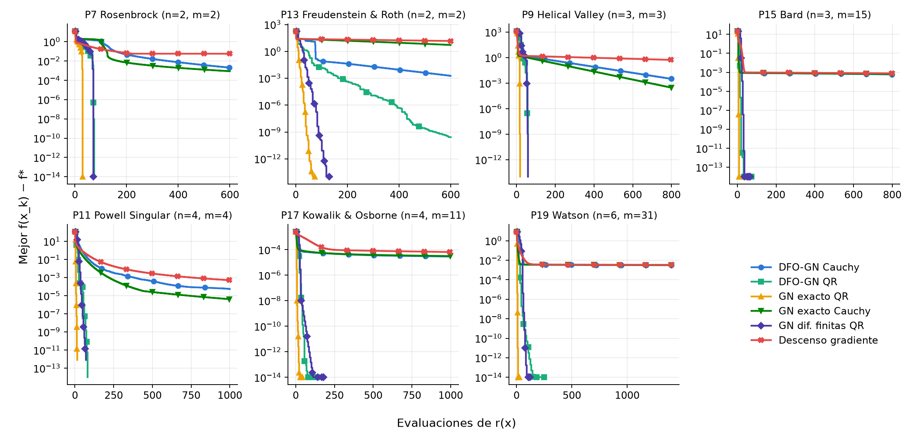
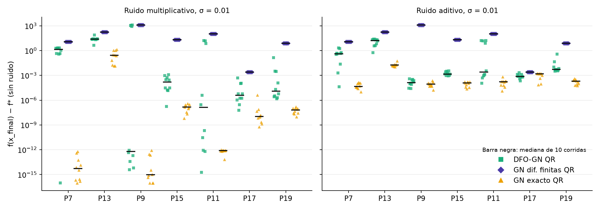

# Proyecto Integrador: Segunda Entrega

## Implementación de un método Gauss-Newton libre de derivadas para mínimos cuadrados no lineales

**Artículo base:** *A derivative-free Gauss-Newton method* (Cartis y Roberts, 2019)
**Integrantes:** David Castro, Alejandro Pardo, Tomás Rincón
**Curso:** Métodos Numéricos · **Docente:** Edwin Fernando Muñoz
Universidad Externado de Colombia · Bogotá, 2026

---

## 1. Modificación metodológica del artículo

Implementamos una versión simplificada de DFO-GN para minimizar f(x) = ½‖r(x)‖² sin derivadas de r, y la comparamos con métodos que sí las usan o las aproximan. Atendemos las cuatro observaciones de la retroalimentación: **problemas de prueba** definidos (sección 3), **tolerancias** explícitas (sección 3), **generación del ruido** precisada (sección 3) y **elementos conservados** del algoritmo original (Tabla 1).

### 1.1 Metodología del artículo original

DFO-GN resuelve mínimos cuadrados no lineales sin derivadas de r. En cada iteración construye, a partir de n+1 puntos con geometría Λ-poised, un Jacobiano aproximado por interpolación lineal (ecs. 2.2–2.4); resuelve el subproblema de región de confianza con una rutina tipo DFBOLS/BOBYQA; compara el descenso real frente al predicho con el cociente Rₖ y actualiza el radio Δₖ (sección 2.2); y protege ese radio mediante fases de criticidad y de seguridad con un radio ρₖ (sección 4.3).

### 1.2 Cambio metodológico propuesto

Nuestra versión conserva la idea central —el Jacobiano por interpolación y la región de confianza—, pero sustituye tres piezas del Algoritmo 1:

- El subproblema DFBOLS/BOBYQA se reemplaza por un paso de Gauss-Newton con QR, con el punto de Cauchy como respaldo cuando el paso QR degrada el modelo.
- La geometría Λ-poised se simplifica a una razón de pivotes con reconstrucción de los puntos.
- Las fases de criticidad y de seguridad, con el radio ρₖ, se omiten.

**Tabla 1. Metodología del artículo (Algoritmo 1) frente a nuestra versión.**

| Elemento | Estado | Justificación |
|---|---|---|
| Modelo lineal por interpolación (2.2–2.4) y modelo de f (2.5) | Conservado | Idea central del método |
| Región de confianza, cociente Rₖ con η₁ = 0.1 y η₂ = 0.7 | Conservado | Controla la confianza en el modelo |
| Actualización de Δₖ (2.15) | Simplificado (sin ρₖ) | Reduce parámetros |
| Parada (sección 4.3): f pequeña, Δ < 10⁻¹⁰, presupuesto | Conservado | Comparabilidad |
| Subproblema (rutina tipo DFBOLS/BOBYQA) | Sustituido por Cauchy o QR | Cumple la condición 2.8 del artículo |
| Geometría (Λ-poised) | Simplificado: razón de pivotes y reconstrucción | Criterio más simple de implementar |
| Fases de criticidad y de seguridad, radio ρₖ | Omitidos | Simplificación; efecto discutido en sección 5 |
| Actualización de factorización (sección 4.4) | Omitido | Con n ≤ 6 resolver desde cero es barato |

### 1.3 Justificación del cambio

El punto de Cauchy es un paso de máximo descenso: los experimentos mostraron que por sí solo no alcanza τ = 10⁻⁵ en la mayoría de los problemas. El paso de Gauss-Newton se construye por mínimos cuadrados con QR, que evita las ecuaciones normales (cond(JᵀJ) = cond(J)²). Con n ≤ 6 y m ≤ 31, resolver desde cero el sistema de interpolación (Gauss, n×n) y el de mínimos cuadrados (QR, m×n) es despreciable frente al costo de evaluar r, que es el caso de interés. La simplificación de la geometría parte del supuesto de que eliminar ρₖ reduce parámetros sin afectar de forma drástica la convergencia; la sección 5 muestra que ese supuesto no se sostiene con ruido.

El cambio es coherente con el problema computacional de la primera entrega, donde nos propusimos evaluar (i) el número de evaluaciones, (ii) la estabilidad frente al ruido y (iii) el costo. Añadir el paso QR no estaba en el plan inicial, donde el subproblema era solo Cauchy; eleva el tiempo por iteración (Tabla 4), pero el costo por iteración sigue siendo despreciable frente al de evaluar r, y los sistemas resueltos son pequeños (n ≤ 6, m ≤ 31), como se anticipó entonces.

### 1.4 Resultados esperados

Con la modificación esperábamos:

- converger a f* sin derivadas en los siete problemas de prueba, que el punto de Cauchy por sí solo no alcanza;
- obtener un número de evaluaciones comparable o menor al de las diferencias finitas;
- conservar la capacidad de progresar con ruido, a diferencia de las diferencias finitas;
- simplificar la implementación al quitar ρₖ sin deteriorar la convergencia; la sección 5 muestra que esta última expectativa no se cumplió.

## 2. Métodos numéricos

### 2.1 Métodos seleccionados y su función

El proyecto combina cinco métodos numéricos vistos en el curso, cada uno con una función distinta:

| Método numérico | Función en el algoritmo |
|---|---|
| Eliminación de Gauss con pivoteo parcial | Resolver W Jᵀ = D, el Jacobiano por interpolación (ec. 2.4), con una sola eliminación para los m lados derechos |
| Mínimos cuadrados por QR (Gram-Schmidt modificado) | Resolver min‖Js + r‖ en el paso de Gauss-Newton, evitando las ecuaciones normales |
| Punto de Cauchy | Respaldo del paso QR y garantía de la condición de decrecimiento (2.8) |
| Diferencias finitas hacia adelante (h = √ε·max(1, \|xⱼ\|)) | Comparador: Gauss-Newton con Jacobiano aproximado |
| Descenso del gradiente (tasa η fija) | Comparador: línea base de primer orden |

Todos los métodos de región de confianza comparten un solo núcleo, que combina el **origen de J** con el **tipo de paso**. Así, cada comparación aísla un solo efecto. El álgebra es propia; NumPy almacena los datos y SciPy solo valida. Los comparadores son: Gauss-Newton con Jacobiano exacto; Gauss-Newton con diferencias finitas; y descenso del gradiente con η fija, escogida como la mejor de {10⁻¹, …, 10⁻⁵} para cada problema sin ruido, lo que favorece a este método.

### 2.2 Formulación

Para minimizar f(x) = ½‖r(x)‖², con r: ℝⁿ → ℝᵐ, el modelo de cada iteración es cuadrático:

mₖ(s) = f(xₖ) + gᵀs + ½ sᵀ H s,  con g = Jᵀr y H = JᵀJ   (ec. 2.5)

- **Jacobiano por interpolación (ec. 2.4).** Con n+1 puntos se plantea W Jᵀ = D, donde W tiene filas y_t − xₖ. Los m residuos comparten W, de modo que una eliminación de Gauss con pivoteo parcial resuelve todos los lados derechos. La razón entre el menor y el mayor pivote de W/Δ vigila la geometría: si baja de 10⁻⁸, los puntos se reconstruyen.
- **Paso de Cauchy.** s = −t g con t = min(gᵀg/gᵀHg, Δ/‖g‖): descenso del gradiente con la tasa óptima para el modelo.
- **Paso QR.** Resuelve min‖Js + r‖ con Gram-Schmidt modificado y Rs = −Qᵀr, evitando las ecuaciones normales, que elevan al cuadrado el condicionamiento. Se recorta a Δ. Una primera versión, solo recortada, se detuvo en f ≈ 32 en Freudenstein & Roth (mínimo: 24.49), porque con J casi singular puede incumplir el decrecimiento de Cauchy (ec. 2.8). Por eso se elige el paso, QR o Cauchy, que más baje el modelo.

El paso se acepta o rechaza con el cociente (ecs. 2.6–2.7)

Rₖ = (f(xₖ) − f(xₖ + s)) / (mₖ(0) − mₖ(s)),

y el radio se actualiza con la regla simplificada (2.15): si Rₖ ≥ 0.7 se acepta y Δ ← 2Δ; si 0.1 ≤ Rₖ < 0.7 se acepta y Δ ← max(Δ/2, ‖s‖); si Rₖ < 0.1 se rechaza y Δ ← min(Δ/2, ‖s‖). Esta regla asegura que cada paso baje el modelo al menos tanto como una iteración de Cauchy (ec. 2.8), que es lo que sostiene la convergencia global del método.

### 2.3 Procedimiento computacional

1. Elegir x₀ y Δ₀ = 0.1·max(‖x₀‖∞, 1); construir Y con x₀ y n puntos a distancia Δ₀.
2. Formar W (filas y_t − xₖ) y D (filas r(y_t) − r(xₖ)); resolver W Jᵀ = D por Gauss con pivoteo parcial, una sola eliminación para los m lados derechos.
3. Vigilar la geometría: si min|uᵢᵢ| / max|uᵢᵢ| < 10⁻⁸, reconstruir los puntos.
4. Calcular g = Jᵀr y H = JᵀJ.
5. Calcular el paso de Cauchy y el paso QR; tomar el que más baje el modelo.
6. Evaluar r(xₖ + s) (una evaluación) y calcular Rₖ.
7. Aceptar o rechazar el paso y actualizar Δ según Rₖ; actualizar Y reemplazando un punto por xₖ₊₁ cuando se acepta.
8. Detener si f es pequeña, si Δ < 10⁻¹⁰ o si se agota el presupuesto de 200(n+1) evaluaciones; en caso contrario, volver al paso 2.

### 2.4 Validación

`gauss` y `QR` coinciden con NumPy en 200 sistemas aleatorios (error de QR y de ortogonalidad ≤ 8·10⁻¹⁶). Los siete problemas reproducen el 2f(x₀) de la Tabla 2 del artículo; J analítico coincide con diferencias centradas (error relativo ≤ 2.4·10⁻¹⁰); y `scipy.optimize.least_squares` reproduce los 2f*.

## 3. Datos, implementación y reproducibilidad

**Problemas** (Tabla 2 del artículo, de Moré, Garbow y Hillstrom, 1981; Pk es el problema k de esa tabla): P7 Rosenbrock (2,2), P13 Freudenstein & Roth (2,2; residuo no nulo), P9 Helical Valley (3,3), P15 Bard (3,15), P11 Powell Singular (4,4; J singular en la solución), P17 Kowalik & Osborne (4,11) y P19 Watson (6,31). Las expresiones de r(x) y de su Jacobiano se transcribieron a mano desde esa Tabla 2 (original de Moré, Garbow y Hillstrom, 1981), incluidas las constantes de Bard y de Kowalik & Osborne; se validaron 2f(x₀) contra la tabla y 2f* contra `scipy.optimize.least_squares`.

**Tolerancias.** Métrica del artículo (ec. 5.1): N(τ) es el número de evaluaciones de r hasta f(xₖ) ≤ f* + τ(f(x₀) − f*), con τ ∈ {10⁻¹, 10⁻³, 10⁻⁵}. Presupuesto: 200(n+1) evaluaciones.

**Ruido** (sección 5.2 del artículo). Multiplicativo r̃ᵢ = rᵢ(1+ε) y aditivo r̃ᵢ = rᵢ+ε, con ε ~ N(0, σ²), σ = 10⁻², independiente por componente y evaluación. Diez corridas con `np.random.default_rng(2026+k)`. El algoritmo solo ve el valor ruidoso; la métrica se mide con f real. No incluimos el ruido χ² del artículo.

### 3.1 Reproducibilidad

El código está en tres cuadernos autocontenidos en `Segunda_Entrega/cuadernos/`: `01_metodos_y_validacion` (Gauss, QR, problemas de prueba y validación), `02_dfogn_y_comparadores` (DFO-GN por partes y comparadores) y `03_experimentos` (tablas y figuras del informe). Cada uno se ejecuta completo en Colab o Jupyter, en ese orden. Parámetros fijos: semilla `SEMILLA = 2026`, tolerancias τ ∈ {10⁻¹, 10⁻³, 10⁻⁵}, ruido σ = 10⁻² y presupuesto 200(n+1). Entorno: Python 3.12, NumPy 2.5.4, SciPy 1.18.1, Matplotlib 3.11.2 y Pandas 3.1.0.

El cuaderno `03` regenera las cinco tablas de datos y las dos figuras; en dos ejecuciones los resultados coincidieron, salvo las columnas de tiempo. Los archivos que respaldan cada resultado del informe son:

| Resultado del informe | Archivo en `resultados/` |
|---|---|
| Tabla 2 (evaluaciones sin ruido) | e1_evaluaciones.csv |
| Orden de convergencia | e2_orden.csv |
| Tabla 3 y Figura 2 (ruido) | e3_ruido.csv |
| Tabla 4 (costo por iteración) | e4_costo.csv |
| Tasa del descenso del gradiente (η) | e5_tasa_dg.csv |

## 4. Resultados y comparación

**Tabla 2. N(τ = 10⁻⁵) sin ruido: evaluaciones de r (— = no alcanzado).** GN exacto requiere además J; DG usa J exacto.

| Problema | DFO-GN QR | DFO-GN Cauchy | GN exacto QR | GN exacto Cauchy | GN dif. finitas QR | DG |
|---|--:|--:|--:|--:|--:|--:|
| P7 Rosenbrock | 71 | — | 29 | — | 71 | — |
| P13 Freudenstein & Roth | 157 | — | 19 | — | 45 | — |
| P9 Helical Valley | 55 | 633 | 16 | 457 | 52 | — |
| P15 Bard | 14 | — | 6 | — | 24 | — |
| P11 Powell Singular | 26 | 371 | 7 | 214 | 35 | 729 |
| P17 Kowalik & Osborne | 35 | — | 8 | — | 36 | — |
| P19 Watson | 33 | — | 8 | — | 56 | — |

**Figura 1. Convergencia sin ruido:** mejor f(xₖ) − f* contra evaluaciones de r.

**El paso limita más que el origen de J.** La Tabla 2 y la Figura 1 muestran que Cauchy alcanza τ = 10⁻⁵ solo en 2 de 7 problemas, con J interpolado o exacto, y sus curvas son paralelas a las del descenso del gradiente: tener derivadas exactas no lo rescata. Es coherente, porque Cauchy es un paso de máximo descenso. Con QR, en cambio, DFO-GN resuelve los 7 problemas.

**DFO-GN frente a diferencias finitas.** Sin usar derivadas, DFO-GN QR necesitó menos evaluaciones en 4 de 7 problemas (Bard, Powell, Kowalik, Watson), empató en Rosenbrock y necesitó más en Helical Valley (por poco) y Freudenstein & Roth (3.5 veces). Reutilizar puntos cuesta 1.3–3.2 evaluaciones por iteración, frente a 1.9–5.0, pero exige más iteraciones.

**Orden de convergencia.** Con eₖ = ‖xₖ − x*‖, GN exacto muestra p ≈ 1.0 en Bard, Powell Singular, Kowalik y Watson, lo esperable con residuo no nulo o J singular. En Rosenbrock y Helical Valley hay muy pocos iterados en la zona asintótica para estimarlo, y en Freudenstein & Roth y en DFO-GN el estimador fue inestable, por lo que no sacamos conclusión.

**Tabla 3. Corridas con éxito, de 70 (7 problemas × 10 semillas), multiplicativo / aditivo.**

| Método | τ = 10⁻¹ | τ = 10⁻³ | τ = 10⁻⁵ |
|---|:--:|:--:|:--:|
| DFO-GN QR | 49 / 51 | 38 / 35 | 25 / 14 |
| DFO-GN Cauchy | 24 / 22 | 12 / 12 | 0 / 0 |
| GN dif. finitas QR | 0 / 0 | 0 / 0 | 0 / 0 |
| GN exacto QR (usa J exacto) | 70 / 62 | 64 / 60 | 57 / 44 |
| Descenso del gradiente (usa J exacto) | 70 / 70 | 40 / 40 | 10 / 10 |

**Figura 2. Brecha final con ruido por problema, en 10 corridas.**

**Robustez.** Es el resultado más claro. GN con diferencias finitas fracasa en las 140 corridas y queda en f(x₀) (Figura 2): con h ≈ 10⁻⁸ y σ = 10⁻², el ruido en J es del orden de σ/h ≈ 10⁶, lo que confirma la motivación del artículo. DFO-GN QR, también sin derivadas, sí progresa, aunque con mucha dispersión: en Helical Valley y Powell Singular la Figura 2 muestra corridas casi perfectas junto a otras que no avanzan. Los métodos con J exacto son una referencia, no una alternativa real, porque en un problema sin derivadas no están disponibles.

**Tabla 4. Costo por iteración (rango entre problemas).**

| Método | Evaluaciones de r | Tiempo (ms) | Sistema resuelto |
|---|:--:|:--:|---|
| DFO-GN QR | 1.32–3.20 | 0.19–0.71 | Gauss n×n con m lados derechos + QR m×n |
| GN exacto QR | 1.00 (+ J) | 0.10–0.42 | QR m×n |
| GN dif. finitas QR | 1.87–5.00 | 0.10–0.34 | QR m×n |

La iteración de DFO-GN QR tarda más en tiempo de pared, porque hace Gauss y QR. Esto importa poco cuando r es costosa, que es el caso de interés: ahí domina el número de evaluaciones.

## 5. Análisis preliminar

**Fortalezas.** DFO-GN QR converge a los valores de referencia en los 7 problemas sin derivadas y, a diferencia de las diferencias finitas, tolera el ruido.

**Limitaciones.** (i) Cauchy solo no basta para alta precisión. (ii) Freudenstein & Roth consume todo el presupuesto, un problema con residuo no nulo. (iii) Con ruido, entre 60 y 70 de las 70 corridas de DFO-GN QR terminan por radio pequeño: sospechamos que los rechazos causados por el ruido encogen Δ, de modo que el error de J (≈ σ/Δ) crece. El radio ρₖ que omitimos existe justamente para acotar esa reducción; aún no lo hemos comprobado experimentalmente. (iv) Siete problemas no permiten generalizar.

**Dificultades de implementación.** El paso QR solo recortado se estancó en f ≈ 32 en Freudenstein & Roth y obligó a elegir, entre QR y Cauchy, el de mayor descenso del modelo. La lógica de reconstrucción de los puntos (razón de pivotes < 10⁻⁸) exigió decidir cuándo la geometría es inaceptable y cómo regenerar el conjunto. Fue necesario delimitar con precisión qué cuenta como evaluación: el Jacobiano exacto de los comparadores no se cobra en N(τ) y `f_real` nunca es vista por el algoritmo. El ruido se genera por evaluación, no por iteración, lo que afecta la reutilización de puntos entre iteraciones. Por último, el código de los métodos está duplicado en los cuadernos 02 y 03 para que cada uno sea autocontenido, a costa de riesgo de divergencia entre copias.

**Tabla 5. Artículo frente a nuestra implementación.**

| Aspecto | Artículo | Nosotros | Consecuencia |
|---|---|---|---|
| Problemas | 53 | 7 | Sin perfiles de datos; comparación por problema |
| Comparadores | BOBYQA, DFBOLS, POUNDERS | GN exacto, GN-DF, DG | **No podemos contrastar** su ventaja de tiempo (7 a 444 veces frente a Py-DFBOLS) |
| Subproblema | Rutina DFBOLS/BOBYQA | Cauchy o QR + Cauchy | Cauchy solo es más lento |
| Geometría | Λ-poised | Razón de pivotes | Implementación simple; posiblemente más evaluaciones |
| Protección de Δ | ρₖ | Ninguna | Probable pérdida de robustez con ruido |

Nuestros resultados apoyan la motivación del artículo: la interpolación cuesta un número de evaluaciones comparable al de las diferencias finitas, sin fracasar con ruido. El artículo no hace esta comparación, sino que enfrenta a DFO-GN con otros métodos sin derivadas, de modo que no reproducimos sus cifras.

**Mejoras para la entrega final.** Incorporar ρₖ y medir su efecto con ruido (prioritaria); añadir los tiempos con r costosa simulada; probar más problemas y perfiles de datos; analizar el ruido con las herramientas de Monte Carlo (S25–S27).

## 6. Conclusiones preliminares

- Interpolar J con Gauss y dar el paso con QR produce un método sin derivadas que resuelve los 7 problemas a τ = 10⁻⁵ sin ruido.
- La elección del paso pesa más que el origen de J: Cauchy limita incluso con derivadas exactas.
- Con ruido, las diferencias finitas fracasan por completo y DFO-GN conserva capacidad de avance, aunque irregular.
- La mejora prioritaria es proteger el radio frente al ruido.
- En conjunto, el hilo artículo → modificación → método → resultados es coherente: la interpolación y la región de confianza provienen del artículo, el paso QR es el cambio que hace viable la precisión, y los resultados confirman la motivación del método frente a las diferencias finitas.

## Declaración de uso de inteligencia artificial

Usamos asistentes de inteligencia artificial como apoyo en distintas etapas del proyecto. Claude Sonnet 5.5 (Anthropic) se empleó en la redacción inicial del código en Python, la propuesta de los experimentos y el primer borrador de este informe. Los modelos DeepSeek V4.1 Flash y DeepSeek V4 Pro se usaron en la revisión cruzada del documento, el ajuste de su estructura a los lineamientos de la entrega y la verificación de la reproducibilidad. Los resultados provienen de la ejecución del código. Como grupo, analizamos línea por línea que todo siguiera los lineamientos del curso.

## Referencias

- Cartis, C., & Roberts, L. (2019). A derivative-free Gauss-Newton method. *Mathematical Programming Computation*, 11, 631–674.
- Moré, J. J., Garbow, B. S., & Hillstrom, K. E. (1981). Testing unconstrained optimization software. *ACM TOMS*, 7(1), 17–41.
- Moré, J. J., & Wild, S. M. (2009). Benchmarking derivative-free optimization algorithms. *SIAM Journal on Optimization*, 20(1), 172–191.
- Nocedal, J., & Wright, S. J. (2006). *Numerical Optimization* (2.ª ed.). Springer.
- Turner, P. R., Arildsen, T., & Kavanagh, K. (2018). *Applied Scientific Computing With Python*. Springer.

## Anexo: código

Tres cuadernos ejecutables en Colab o Jupyter, en la carpeta `Segunda_Entrega/cuadernos` de https://github.com/AlejandroP212/metodos-numericos-dfo-gn : `01_metodos_y_validacion`, `02_dfogn_y_comparadores` y `03_experimentos`.
